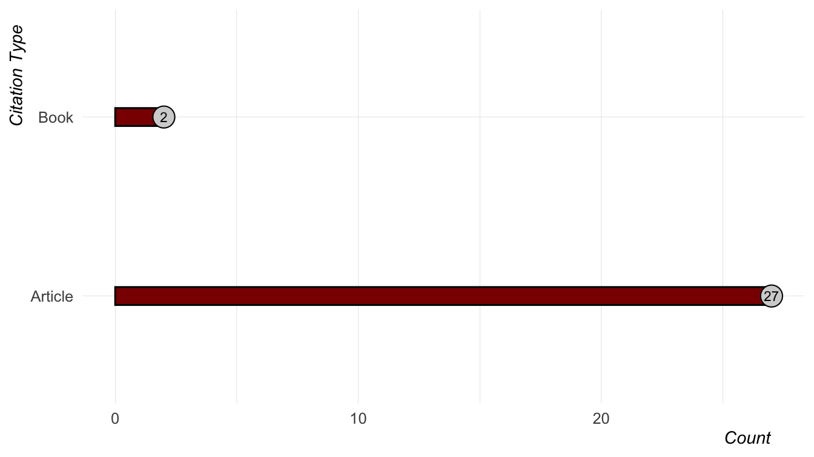
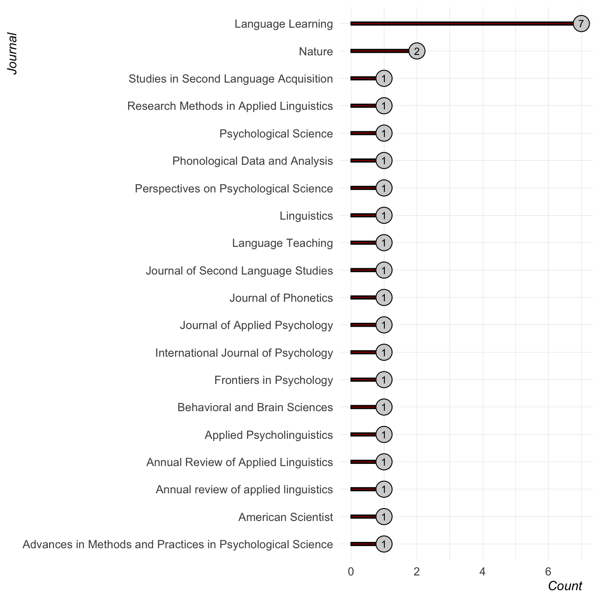
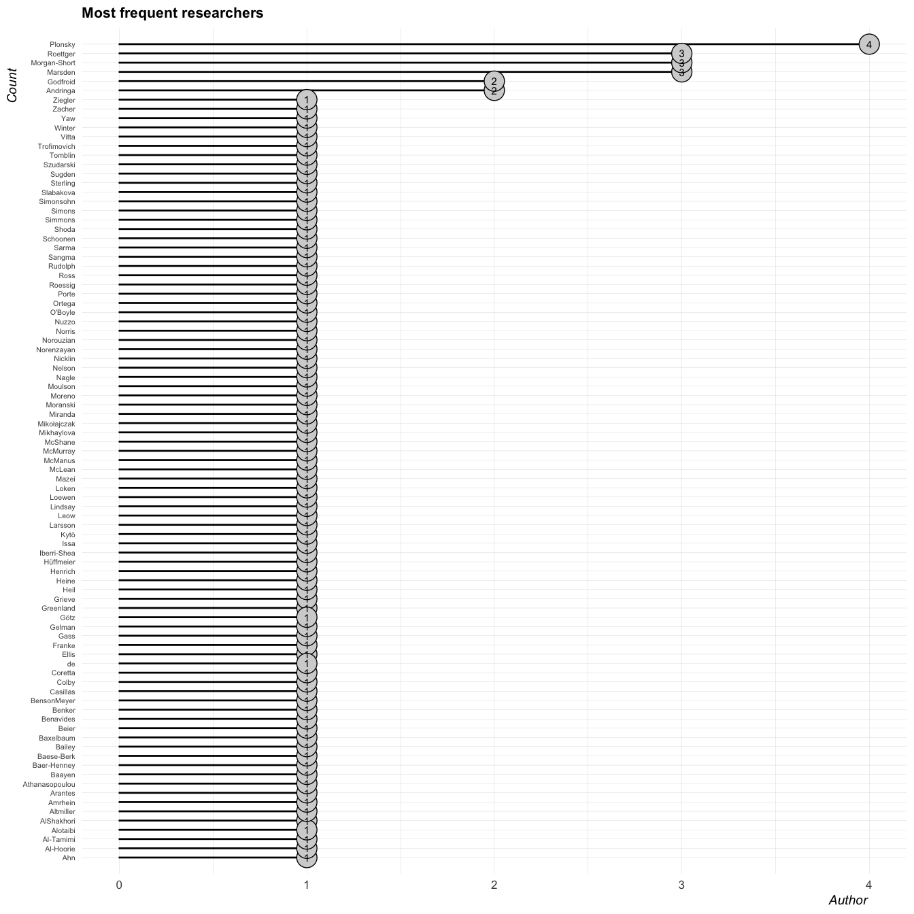
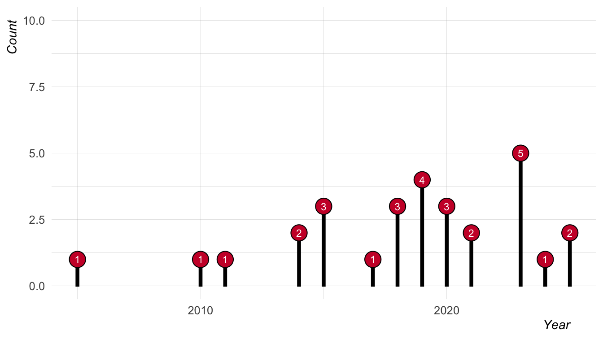

# Forking Paths, Open Doors references
Joseph V. Casillas
2026-11-06

## Citation Types

## Journals

## Authors

## Publication Years

# Reference list

Amrhein, Valentin, Sander Greenland, and Blake McShane. 2019.
“Scientists Rise up Against Statistical Significance.” *Nature* 567:
305–7. <https://doi.org/10.1038/d41586-019-00857-9>.

Andringa, Sible, and Aline Godfroid. 2020. “Sampling Bias and the
Problem of Generalizability in Applied Linguistics.” *Annual Review of
Applied Linguistics* 40: 134–42.
<https://doi.org/10.1017/s0267190520000033>.

Coretta, Stefano, Joseph V. Casillas, Simone Roessig, Michael Franke, B.
Ahn, Ali H. Al-Hoorie, Jalal Al-Tamimi, et al. 2023. “Multidimensional
Signals and Analytic Flexibility: Estimating Degrees of Freedom in
Human-Speech Analyses.” *Advances in Methods and Practices in
Psychological Science* 6 (3): 25152459231162567.
<https://doi.org/10.1177/25152459231162567>.

Gass, Susan, Shawn Loewen, and Luke Plonsky. 2020. “Coming of Age: The
Past, Present, and Future of Quantitative SLA Research.” *Language
Teaching* 54 (2): 245–58. <https://doi.org/10.1017/s0261444819000430>.

Gelman, Andrew, and Eric Loken. 2014. “The Statistical Crisis in
Science: Data-Dependent Analysis—a ‘Garden of Forking Paths’—Explains
Why Many Statistically Significant Comparisons Don’t Hold Up.” *American
Scientist* 102 (6): 460–66. <https://doi.org/10.1511/2014.111.460>.

Godfroid, Aline, and Sible Andringa. 2023. “Uncovering Sampling Biases,
Advancing Inclusivity, and Rethinking Theoretical Accounts in Second
Language Acquisition: Introduction to the Special Issue SLA for All?”
*Language Learning* 73 (4): 981–1002.
<https://doi.org/10.1111/lang.12620>.

Götz, Michael, Anita Sarma, and Ernest H. O’Boyle. 2024. “The Multiverse
of Universes: A Tutorial to Plan, Execute and Interpret Multiverses
Analyses Using the r Package Multiverse.” *International Journal of
Psychology* 59: 1003–14. <https://doi.org/10.1002/ijop.13229>.

Grieve, Jack. 2021. “Observation, Experimentation, and Replication in
Linguistics.” *Linguistics* 59 (5): 1343–56.
<https://doi.org/10.1515/ling-2021-0094>.

Henrich, Joseph, Steven J. Heine, and Ara Norenzayan. 2010. “The
Weirdest People in the World?” *Behavioral and Brain Sciences* 33 (2-3):
61–83. <https://doi.org/10.1017/S0140525X0999152X>.

Marsden, Emma, and Kara Morgan-Short. 2023. “(Why) Are Open Research
Practices the Future for the Study of Language Learning?” *Language
Learning*. <https://doi.org/10.1111/lang.12568>.

Marsden, Emma, Kara Morgan-Short, Pavel Trofimovich, and Nick C. Ellis.
2018. “Introducing Registered Reports at Language Learning: Promoting
Transparency, Replication, and a Synthetic Ethic in the Language
Sciences.” *Language Learning* 68 (2): 309–20.
<https://doi.org/10.1111/lang.12284>.

Mazei, Julia, Cort W. Rudolph, Hannes Zacher, and Joachim Hüffmeier.
2025. “Do Not Put All of Your Eggs in One Basket: Multiverse Analysis in
Applied Psychology.” *Journal of Applied Psychology* 110 (11): 1511–37.
<https://doi.org/10.1037/apl0001291>.

McMurray, Bob, Karen S. Baxelbaum, Susan Colby, and J. Bruce Tomblin.
2023. “Understanding Language Processing in Variable Populations on
Their Own Terms.” *Applied Psycholinguistics* 44 (4): 565–92.
<https://doi.org/10.1017/S0142716423000255>.

Moranski, Kara, and Norbert Ziegler. 2020. “A Case for Multisite Second
Language Acquisition Research.” *Language Learning* 71 (1): 204–42.
<https://doi.org/10.1111/lang.12434>.

Morgan-Short, Kara, Emma Marsden, Jeanne Heil, B. I. Issa, Ronald P.
Leow, Anna Mikhaylova, S. Mikołajczak, Noelia Moreno, Roumyana
Slabakova, and Pawel Szudarski. 2018. “Multisite Replication in Second
Language Acquisition Research.” *Language Learning* 68 (2): 392–437.
<https://doi.org/10.1111/lang.12292>.

Nagle, Charlie L. 2023. “A Design Framework for Longitudinal Individual
Difference Research: Conceptual, Methodological, and Analytical
Considerations.” *Research Methods in Applied Linguistics* 2 (1):
100033. <https://doi.org/10.1016/j.rmal.2022.100033>.

Norouzian, Ramin, M. de Miranda, and Luke Plonsky. 2018. “The Bayesian
Revolution in Second Language Research.” *Language Learning* 68 (4):
1032–75. <https://doi.org/10.1111/lang.12310>.

Norris, John M., Luke Plonsky, Steven J. Ross, and Rob Schoonen. 2015.
“Guidelines for Reporting Quantitative Methods and Results in Primary
Research.” *Language Learning* 65 (2): 470–76.
<https://doi.org/10.1111/lang.12104>.

Nuzzo, Regina. 2014. “Scientific Method: Statistical Errors.” *Nature*
506 (7487): 150–52. <https://doi.org/10.1038/506150a>.

Ortega, Lourdes, and Gina Iberri-Shea. 2005. “Longitudinal Research in
Second Language Acquisition: Recent Trends and Future Directions.”
*Annual Review of Applied Linguistics* 25: 26–45.
[https://doi.org/10.1017/S0267190505000024
](https://doi.org/10.1017/S0267190505000024 ).

Plonsky, Luke, ed. 2015. *Advancing Quantitative Methods in Second
Language Research*. Routledge.

Plonsky, Luke, Sam Sterling, Kevin Yaw, T. Larsson, and Merja Kytö.
2025. “Expanding the Scope of Questionable Research Practices in Applied
Linguistics.” *Journal of Second Language Studies*.
<https://doi.org/10.1075/jsls.00060.plo>.

Porte, Graeme, and Kevin McManus. 2019. *Doing Replication Research in
Applied Linguistics*. Routledge.

Roettger, Timo B., and Dinah Baer-Henney. 2019. “Towards a Replication
Culture in Phonetic Research.” *Phonological Data and Analysis* 1 (4):
1–23. <https://doi.org/10.3765/pda.v1art4.13>.

Roettger, Timo B., Bodo Winter, and Harald Baayen. 2019. “Emergent Data
Analysis in Phonetic Sciences.” *Journal of Phonetics* 73: 1–7.
<https://doi.org/10.1016/j.wocn.2018.12.001>.

Simmons, Joseph P., Leif D. Nelson, and Uri Simonsohn. 2011.
“False-Positive Psychology: Undisclosed Flexibility in Data Collection
and Analysis Allows Presenting Anything as Significant.” *Psychological
Science* 22 (11): 1359–66. <https://doi.org/10.1177/0956797611417632>.

Simons, Daniel J., Yuichi Shoda, and D. Stephen Lindsay. 2017.
“Constraints on Generality (COG): A Proposed Addition to All Empirical
Papers.” *Perspectives on Psychological Science* 12 (6): 1123–28.
<https://doi.org/10.1177/1745691617708630>.

Sugden, Nicholas A., and Margaret C. Moulson. 2015. “Recruitment
Strategies Should Not Be Randomly Selected.” *Frontiers in Psychology*
6: 523. <https://doi.org/10.3389/fpsyg.2015.00523>.

Vitta, Joseph P., Christopher Nicklin, and Stuart McLean. 2021. “Effect
Size–Driven Sample-Size Planning, Randomization, and Multisite Use in L2
Instructed Vocabulary Acquisition Experimental Samples.” *Studies in
Second Language Acquisition* 44 (5): 1424–48.
<https://doi.org/10.1017/S0272263121000541>.

